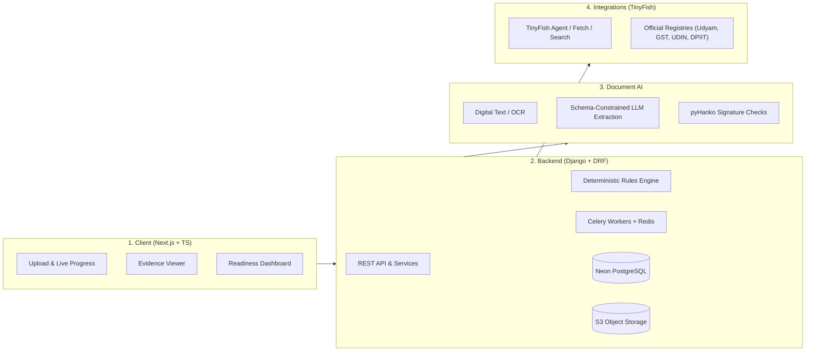
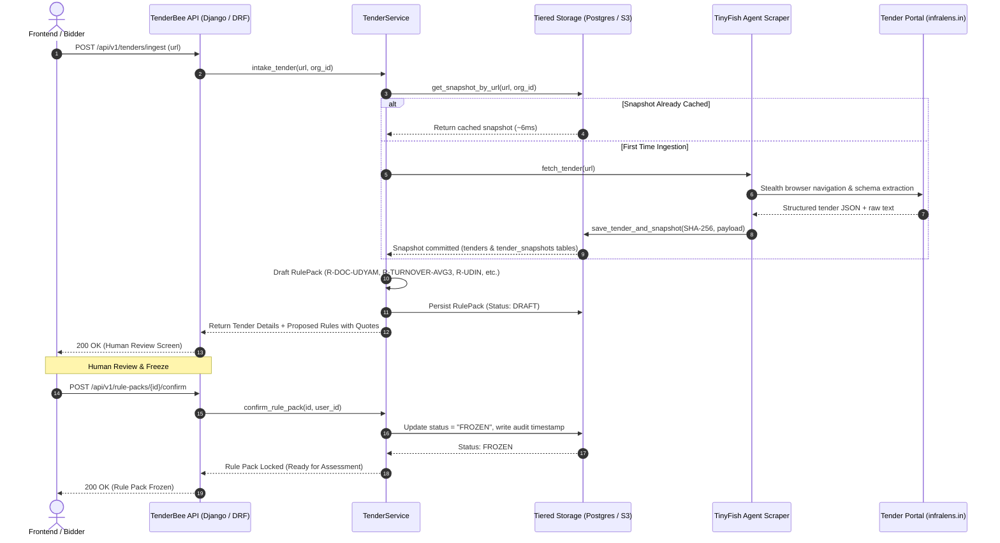

# TenderBee

> **"AI extracts. Deterministic rules decide. Official sources confirm."**

TenderBee is an Intelligent Tender Platform built to eliminate guesswork and hallucination from government and enterprise tender bidding. The platform spans three primary modules:
- **Find**: Automated tender discovery and eligibility fit scoring.
- **Verify**: Document verification, digital signature integrity, and bid-readiness validation.
- **Prepare**: Proposal drafting, compliant document compilation, and bid submission packaging.

All three modules operate on one unified core: a human-confirmed rule pack per tender, machine-verified evidence per fact, a pure-Python deterministic rules engine, and an immutable audit trail.

---

## Technical Architecture Overview



### Architectural Blocks

1. **Client (Next.js + TypeScript)**:
   - Modern App Router architecture with dedicated module route groups (`(find)`, `(verify)`, `(prepare)`).
   - Real-time upload progress, side-by-side evidence viewer, and bid-readiness score banners.

2. **Backend Core (Django + DRF)**:
   - High-throughput REST API with asynchronous job distribution via Celery and Redis.
   - Decoupled, pure-Python deterministic rules engine with zero network/database dependencies (`core/engine`).
   - Serverless PostgreSQL (Neon) and S3-compatible document storage.

3. **Document AI Layer**:
   - Multi-format ingestion: digital PDFs, scans (OCR), and raw documents.
   - Strict schema-constrained LLM value extraction (JSON output only).
   - Digital cryptographic signature validation via `pyHanko`.

4. **Integrations Layer (TinyFish)**:
   - Headless stealth browsing, search, and dynamic portal scraping via TinyFish APIs.
   - Verification against authoritative government portals (Udyam, GSTN, ICAI UDIN, and DPIIT).

---

## Architectural Invariants (By the Numbers)

| Metric | Target | Rationale |
| :---: | :---: | :--- |
| **7** | **Pipeline Stages** | Rigorous step-by-step verification pipeline from file ingestion to user verdict. |
| **5** | **Verification Layers** | File integrity, cryptographic signature, OCR/data extraction, rule validation, registry confirmation. |
| **0** | **LLM Pass/Fail Calls** | The LLM **never** decides compliance or eligibility; it only extracts values and proposes draft rules. Pass/fail is strictly deterministic. |
| **4** | **Verdicts (No Silent Accept)** | Explicit outcomes: `Pass`, `Fail`, `Discrepancy`, `Incomplete`. |

---

## The Seven Pipeline Stages

```text
 ┌─────────────┐    ┌─────────────┐    ┌─────────────┐    ┌─────────────┐
 │   Stage 1   │ -> │   Stage 2   │ -> │   Stage 3   │ -> │   Stage 4   │
 │ Upload &    │    │ OCR & Text  │    │ LLM         │    │ Validation  │
 │ Integrity   │    │ Extraction  │    │ Extraction  │    │ Rules       │
 └─────────────┘    └─────────────┘    └─────────────┘    └─────────────┘
  (File Checks)      (Extract Text)     (AI Extract)       (Rule Engine)
         │
         v
 ┌─────────────┐    ┌─────────────┐    ┌─────────────┐
 │   Stage 5   │ -> │   Stage 6   │ -> │   Stage 7   │
 │ Profile &   │    │ External    │    │ Verdict &   │
 │ Tender Fit  │    │ Verification│    │ Evidence    │
 └─────────────┘    └─────────────┘    └─────────────┘
  (Profile Fit)      (TinyFish API)     (User Ack.)
```

1. **Upload and Integrity**: File validation, malware scan, checksum calculation (SHA-256), and cryptographic signature checks (`pyHanko`).
2. **OCR / Text Extraction**: High-fidelity text extraction from PDFs and scanned documents.
3. **LLM Extraction**: Schema-constrained entity and value extraction (Pydantic / JSON schema).
4. **Validation Rules**: Pure-Python deterministic rule evaluation against extracted facts.
5. **Profile + Tender Checks**: Company capabilities and eligibility matching against tender criteria.
6. **External Verification**: Cross-verification of facts (e.g. GST active status, Udyam MSME class, UDIN validity) via TinyFish.
7. **Verdict + Evidence**: Final composite verdict presented alongside highlighted document evidence for user sign-off.

---

## Workflow: Tender Intake & Rule Pack Freezing

The diagram below illustrates the ingestion and rule-freezing lifecycle:



---

## Technology Stack

| Category | Component | Purpose |
| :--- | :--- | :--- |
| **Frontend** | Next.js (App Router), TypeScript | Evidence viewer, live progress, review screens, readiness banner |
| **Backend API** | Django 5.x, Django REST Framework | Domain services, authentication, RESTful APIs, business models |
| **Rules Engine** | Pure-Python (`core/engine`) | Isolated, deterministic evaluation; zero database/network dependencies |
| **Async Tasks** | Celery, Redis | Document intake, external portal verification, PDF rendering |
| **Database** | Neon Serverless PostgreSQL | Relational storage, connection-pooled queries, immutable audit logs |
| **Storage** | S3-Compatible Object Storage | Raw PDFs, tender snapshots, extracted page artifacts, evidence crops |
| **LLM & Extraction** | Provider-Agnostic Adapter, Pydantic | Schema-constrained entity extraction & rule proposal (JSON output only) |
| **Signatures & OCR** | pyHanko, PDF parsing | Digital signature verification and text extraction |
| **External Agent** | TinyFish APIs | Headless browsing, dynamic portal scraping, and registry lookups |
| **Containers** | Docker, Docker Compose | Service orchestration (backend, worker, redis, frontend) |

---

## Neon Serverless Database Configuration

TenderBee connects to Neon serverless PostgreSQL using a dual-connection architecture:

> **Database Connection Rules:**
> - **Runtime Application**: Connects to the **pooled connection string** (`DATABASE_URL`) to support serverless autoscaling and connection pooling. Django settings enforce a short connection lifetime (`conn_max_age = 0-60`) to accommodate serverless idle suspension.
> - **Database Migrations**: Migrations **must** run against the **direct session string** (`DIRECT_URL`) because schema migrations require session-level locking and are unsupported on transaction poolers.

```bash
# Execute migrations using DIRECT_URL
make migrate
```

## Local PDF extraction demo

From the repository root, extract text and locally detected fields from one or more PDFs:

```powershell
python scripts\extract_documents.py "D:\path\to\application.pdf" --output .\extraction.json
```

For output shaped by a JSON Schema, pass the schema and one or more application PDFs:

```powershell
python scripts\extract_documents.py `
  --schema samples\application_extraction.schema.json `
  --application bidder-udyam.pdf `
  --application ca_turnover_certificate=bidder-turnover.pdf `
  --output .\extracted.json `
  --evidence .\evidence.json
```

The CLI extracts only; it does not compare documents with tender requirements or produce an eligibility verdict. OCR for scanned PDFs requires the Python packages in `requirements.txt` and the Tesseract executable. On Windows, set `TESSERACT_CMD` if Tesseract is not installed at its standard path. `python backend\demo_cli.py` remains available as a compatibility entry point.

Document intake and extraction orchestration live in `backend/apps/documents/services.py`; reusable grounding and OCR policies live in `backend/engine/grounding.py` and `backend/engine/ocr_policy.py`; the extraction CLI lives in `scripts/extract_documents.py`. `backend/services/document_ai.py` is a compatibility facade.

Prompt-injection screening is heuristic defense-in-depth. Suspicious uploads are marked for human review and withheld from LLM extraction, and verification recomputes the stored PDF SHA-256 before using it. A digest stored alongside the document is not protection against an attacker who can alter both the file and its database record.
