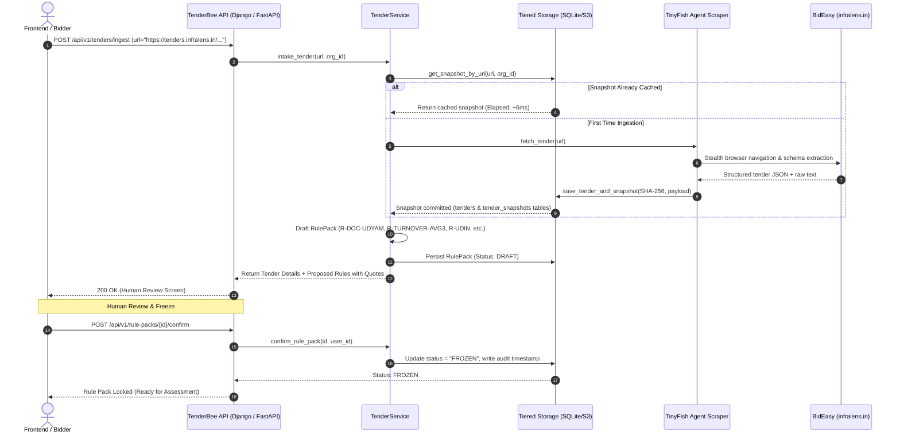

# TenderBee Tender Ingestion & Rule-Pack API Guide

> **Core Philosophy:** *AI extracts and drafts, humans confirm, deterministic code decides. No evidence, no verdict.*

This document provides a comprehensive, production-level guide to TenderBee's **Tender Ingestion, Scraping, and Rule-Pack Storage API**. It explains **why** this architecture was chosen, **how** it functions end-to-end, and **how** each team member (Backend, Frontend, AI/ML) uses it.

---

## 1. Executive Summary & The "Why"

### The Real-World Problem
In Indian public procurement (GeM, CPPP, and aggregators like BidEasy/Infralens), small businesses (MSMEs) face severe challenges:
1. **Aggregators don't check eligibility:** Platforms index millions of tenders by keyword, but never inspect whether the bidder's specific Udyam certificate, turnover balance sheets, or UDIN satisfy the tender's mandatory clauses.
2. **Web portals are heavily protected:** Portals like Infralens and GeM use Cloudflare, dynamic client-side rendering (React/Next.js), and aggressive anti-bot protections. Standard HTTP scrapers (`requests`, `curl`, BeautifulSoup) fail with `403 Forbidden` or `bot_blocked`.
3. **Corrigendums destroy auditability:** Government buyers frequently issue amendments (corrigendums) that change turnover thresholds or extend deadlines. If an application updates records in place, it destroys the audit trail of what the bidder verified against.

### The TenderBee Solution
TenderBee decouples the compliance problem into a reliable, legally defensible pipeline:
* **TinyFish Stealth Agent:** Bypasses bot protections, renders dynamic pages, and extracts structured tender metadata directly against a strict JSON schema.
* **Content-Addressed Immutability:** Every scrape is hashed via **SHA-256**. Amendments create new snapshots; past assessments are never silently overwritten.
* **Zero-Cost Caching:** Repeated queries load from local tiered storage in **under 10 milliseconds** at **$0 API cost**.
* **Human-Confirmed Rule Packs:** The AI proposes candidate rules with exact clause quotes, but the rules are only executable once a human reviewer freezes the pack (`DRAFT` $\rightarrow$ `FROZEN`).

---

## 2. End-to-End Architecture Flow



---

## 3. Production Storage Architecture

To prevent database bloat while maintaining strict multi-tenant isolation, storage is split into **two tiers**:

### Tier 1: Relational Metadata Database (`data/tenderbee.db`)
Stores structured, indexed fields with `organization_id` tenant scoping:
* `tenders`: Master identity (`tender_id`, `organization_id`, `external_id`, `title`, `buyer_name`, `deadline`, `estimated_value_inr`).
* `tender_snapshots`: Immutable ingest records (`snapshot_id`, `tender_id`, `content_hash`, `raw_payload_path`, `extracted_json_path`, `fetched_at`).
* `rule_packs`: Versioned requirement packs (`rule_pack_id`, `tender_id`, `version`, `status`, `content_hash`, `rules_json`, `confirmed_by`, `confirmed_at`).

### Tier 2: Object Storage (`data/snapshots/`)
Stores large text payloads on disk (or AWS S3 in production cloud deployments) named by content hash:
* `{sha256}_raw.txt`: The raw text/markdown payload scraped from the portal.
* `{sha256}_extracted.json`: The fully validated structured extraction.

---

## 4. API Endpoints Specification

### 1. Ingest Tender (`POST /api/v1/tenders/ingest/`)
Ingests a tender URL or portal ID, initiates extraction, and returns the proposed rule pack.

* **Request Body:**
```json
{
  "source_url": "https://tenders.infralens.in/tender/GEM-2026-B-894210",
  "organization_id": "org_sample_cleaning",
  "force_refresh": false
}
```

* **Response Body (`200 OK` or `202 Accepted`):**
```json
{
  "success": true,
  "is_cached": false,
  "tender_id": "tnd_56c72d8eddb3",
  "tender_number": "GEM/2026/B/894210",
  "tender_title": "Comprehensive Housekeeping and Sanitation Services",
  "buyer_name": "Indian Oil Corporation Limited",
  "submission_deadline": "2026-10-30T15:00:00+05:30",
  "rule_pack_id": "rp_760ad396d3d478a3",
  "rule_pack": {
    "tender_id": "tnd_56c72d8eddb3",
    "version": 1,
    "status": "DRAFT",
    "content_hash": "760ad396d3d478a3f890123...",
    "reference_dates": {
      "submission_deadline": "2026-10-30T15:00:00+05:30"
    },
    "rules": [
      {
        "rule_id": "R-DOC-UDYAM",
        "type": "document_required",
        "mandatory": true,
        "params": {
          "document_type": "udyam_certificate"
        },
        "source": {
          "page": 1,
          "quote": "Bidders claiming MSE exemption must hold valid Udyam certificate covering NIC 812."
        }
      },
      {
        "rule_id": "R-TURNOVER-AVG3",
        "type": "numeric_threshold",
        "mandatory": true,
        "params": {
          "document_type": "ca_turnover_certificate",
          "field": "turnover_by_fy",
          "aggregate": "mean_last_3_completed_fy",
          "n": 3,
          "operator": ">=",
          "threshold_inr": 5000000.0,
          "fy_reference": "submission_deadline"
        },
        "source": {
          "page": 1,
          "quote": "Average annual turnover of last 3 completed financial years must not be less than Rs. 50 Lakhs."
        }
      },
      {
        "rule_id": "R-UDIN",
        "type": "identifier_present",
        "mandatory": true,
        "params": {
          "document_type": "ca_turnover_certificate",
          "field": "udin"
        },
        "source": {
          "page": 1,
          "quote": "CA turnover certificate must carry a valid 18-digit UDIN."
        }
      },
      {
        "rule_id": "R-UDYAM-NIC",
        "type": "field_in_set",
        "mandatory": true,
        "params": {
          "document_type": "udyam_certificate",
          "field": "nic_codes",
          "match": "any_prefix",
          "values": ["812"]
        },
        "source": {
          "page": 1,
          "quote": "Bidders claiming MSE exemption must hold valid Udyam certificate covering NIC 812."
        }
      }
    ]
  }
}
```

---

### 2. Confirm & Freeze Rule Pack (`POST /api/v1/rule-packs/{id}/confirm/`)
Freezes the proposed rules after human review. Assessments can only be run against `FROZEN` rule packs.

* **Request Body:**
```json
{
  "confirmed_by": "user_reviewer_09"
}
```

* **Response Body (`200 OK`):**
```json
{
  "success": true,
  "rule_pack_id": "rp_760ad396d3d478a3",
  "status": "FROZEN",
  "confirmed_by": "user_reviewer_09",
  "confirmed_at": "2026-10-24T15:22:37.123456"
}
```

---

## 5. How to Use in Code

### Option A: Direct Python Import (For Backend & Scripts)
Any backend service or test script can call the engine directly without HTTP overhead:

```python
from tenderbee.apps.tenders.service import TenderService

# 1. Initialize service
service = TenderService()

# 2. Ingest tender from BidEasy (instant if cached, live scrape via TinyFish if new)
result = service.intake_tender(
    url="https://tenders.infralens.in/tender/GEM-2026-B-894210",
    org_id="org_sample_cleaning"
)

print("Tender Title:", result["tender_title"])
print("Rule Pack ID:", result["rule_pack_id"])
print("Number of rules drafted:", len(result["rule_pack"]["rules"]))

# 3. Freeze rule pack after user confirmation
frozen = service.confirm_rule_pack(
    rule_pack_id=result["rule_pack_id"],
    confirmed_by="compliance_officer_1"
)
print("Status:", frozen["status"])  # Output: FROZEN
```

### Option B: Terminal CLI Execution
Run the included test harness to inspect intake and caching from your terminal:

```bash
# Test with default tender URL
.venv/bin/python scripts/test_intake.py

# Or test with any custom Infralens tender URL:
.venv/bin/python scripts/test_intake.py "https://tenders.infralens.in/tender/pind-2627-00220-320314"
```

---

## 6. Security, Integrity & Failure Policies

| Scenario | System Behavior | Reason Code / Status |
| :--- | :--- | :--- |
| **Site Protected by Anti-Bot** | TinyFish Agent automatically activates a stealth browser session with fingerprint emulation to bypass bot blockers. | Handled transparently |
| **Timeout / Unreachable URL** | Returns structured error message; suggests bidder upload tender PDF directly. | `success: false`, `error: "timeout"` |
| **Re-fetched Same URL** | System returns local cached snapshot in < 10ms. | `is_cached: true` ($0 API cost) |
| **Corrigendum / Amended Tender** | SHA-256 fingerprint differs from previous snapshot. A new snapshot row is appended; previous rule packs are marked stale. | `STALE_RULE_PACK` |
| **Assessment Before Confirmation** | Rules engine refuses to evaluate bidder documents against a rule pack whose status is `DRAFT`. | `REVIEW_REQUIRED` |
